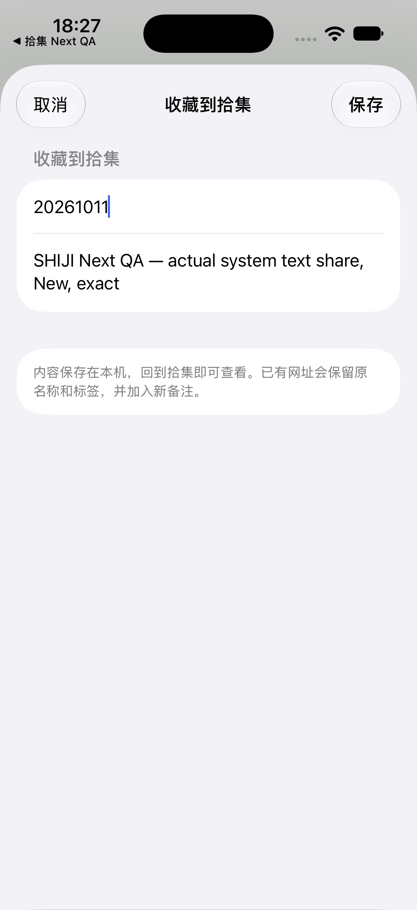
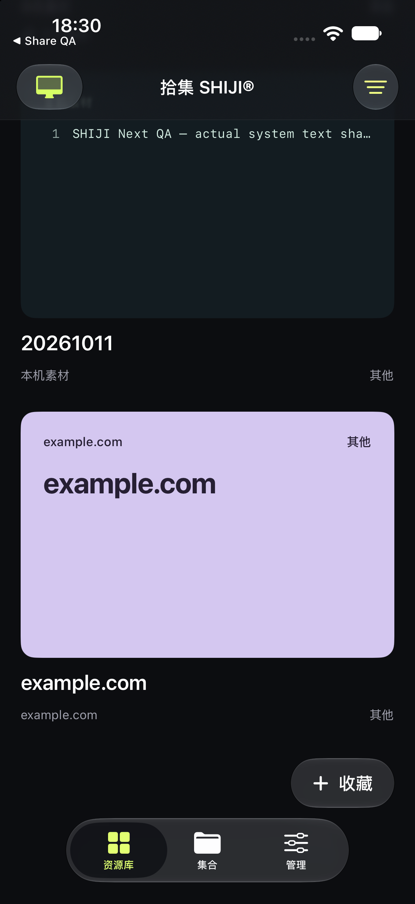
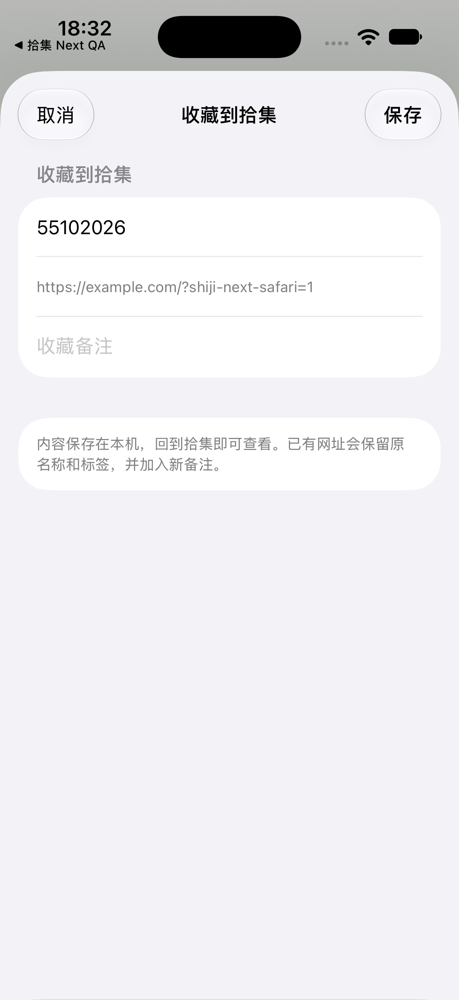
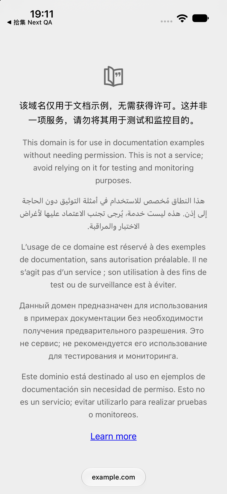

# SHIJI Next — Share Extension 专项，第一轮

2026-10-11；分支 `feat/shiji-next-capture-organize`。本报告区分真实系统分享、核心回归、编译和仍未验收事项。**没有宣称历史空白页已经修复。**

## 实际环境与隔离

- Xcode 27.0（27A266a），iOS 27.0，独立 iPhone 17 模拟器 `Shiji Next Share QA`。
- App `local.silver.shiji.nextqa.app`，扩展 `.share`，App Group `group.local.silver.shiji.nextqa`；仅在临时复制的工程替换身份，产品工程的组和签名配置没有改变。
- 同时核对实际编译包的 principal class、Mach-O、Info/entitlement 和共享组一致性。build成功与系统分享成功分别验证。
- 实际系统分享通过 UIKit `UIActivityViewController` 和 Safari 菜单触发；不是伪造extensionContext或只调用capture函数。
- 扩展表单与桌面UI未改动；共享存储只修正元数据提交失败后的新附件清理，见下文。数据库格式、正式资源和配对凭据均未改动。V5.2长帧风险仍保留。

## 已定位问题和结果

### 1. 旧QA宿主在新SDK下无法启动（已修复，仅QA工具）

第一版沿用旧测试宿主UIApplicationDelegate + UIWindow。安装/launch命令成功后，实际画面回到SpringBoard，运行日志明确出现：`UIScene life cycle is required for apps built with this SDK`。该错误来自ShareQA主进程，尚未启动拾集扩展，不能归因于扩展。

Next QA宿主改用UIApplicationSceneManifest、UISceneConfiguration、UIWindowSceneDelegate以及UIWindow(windowScene:)。重建后实际画面出现四个分享按钮，系统菜单出现拾集，随后扩展可正常绘制。未对产品ShareViewController做无依据的生命周期替换。[Apple场景生命周期说明](https://developer.apple.com/documentation/uikit/transitioning-to-the-uikit-scene-based-life-cycle)支持该SDK迁移要求；扩展仍是系统托管的UIViewController。

证据：`evidence/share-host-runtime.log`（失败）；`share-host-scene-build.log`（修复构建）；以下实际扩展截图。

### 2. 历史持续空白页（本轮未复现，未闭环）

未经修改的V5.2分享实现，在独立身份的新模拟器中，URL、文本、图片及Safari URL均出现真实表单。已有生命周期日志显示providers读取完成和非零root尺寸（402×812或402×874）。

第一次系统菜单有短暂空白，等待系统ShareUIService完成加载后出现活动列表；这发生在选中拾集之前，不是拾集表单持续空白。新模拟器首次键盘还有系统使用提示，以及Device Hub键盘捕获默认关闭；这些验收工具因素已区分。初次图片标题输入未被屏幕确认，实际保存的是默认标题，没有把它报告为手动标题成功。

当前证据不足以断言旧环境是缓存、签名或SwiftUI缺陷。没有添加固定延迟、重复reload或重写产品界面。需要在曾出现故障的安装包/系统或真实iPhone复现并采集相同日志，才能提交根因修复。

### 3. 元数据提交失败遗留附件（已复现并修复存储层）

`LibraryFiles.capture` / `attach` 先调用publish写附件，再由access提交library.json。原实现只在元数据写失败时抛错，没有移除刚发布的文件；用户重试图片保存会留下无引用文件。

复现：独立临时目录先保存原资源/附件；只把Library根设为0500，保持files子目录可写，使新附件写入成功、元数据原子替换失败。新增回归在原实现准确失败：`share-commit-failure-before.log`，断言为“failed commit must remove only its new attachment”。它不是编译错误。

最小修改：两条入口各自记录本次publish的独立UUID路径，提交抛错后只尝试清理该路径，再抛回原错误。不会删除旧附件或改写旧记录。回归分别验证capture/attach失败后的旧元数据字节及附件目录不变，并恢复写权限重试，确认原标题、备注、封面及原附件保留，只有一次新增附件。

完整Swift核心与桌面ZIP互通通过：`share-commit-failure-after.log`；真实HTTPS同步通过：`share-rollback-sync.log`；Python208项（41.508s）、Node52组再次通过：`share-rollback-python.log`、`share-rollback-node.log`；独立iOS simulator App/extension构建与bundle检查通过：`share-rollback-build.log`、`share-rollback-bundle.log`。

修复后的QA包已构建，尚未安装到当前正在进行Safari手工分享的模拟器，避免中断该会话。上面的系统URL/文本/图片保存证据来自修改前的V5.2代码；新的回滚行为只有核心回归证据，尚无修复包的真实错误/重试界面录像。

这是捕获到可返回的写入错误后的回滚，不是跨文件的崩溃事务。如果进程在附件写入后被系统终止，或文件系统连删除也拒绝，仍可能遗留文件。本轮没有引入清理全部附件的危险扫描。系统分享错误界面及再次保存的端到端验收仍须单独完成，不能用上述核心测试代替。

## 真实运行验收矩阵

| 场景 | 实际执行结果 | 证据/限制 |
|---|---|---|
| QA宿主URL → 系统菜单 → 拾集 → 保存 | 通过；App Group schema3有真实记录 | URL `https://example.com/shiji-next-share-qa`，默认域名标题 |
| QA宿主文本 → 系统菜单 → 拾集 → 手动标题 → 保存 | 通过 | 标题实际输入并确认 `20261011`；备注为完整QA文本，逗号保留；`share-text-form.png` |
| QA宿主UIImage → 系统菜单 → 拾集 → 保存 | 通过 | 本地JPEG，32,724 bytes；SHA-256匹配，附件被设为封面；图片默认标题 |
| 主App回到前台回读以上3条 | 通过 | 界面显示3条；实际滑动看到文本/URL卡片；`main-readback-text-url.png`。截图不是Demo数据 |
| Safari网页 → Safari分享菜单 → 拾集读取 | 通过 | `https://example.com/?shiji-next-safari=1`，表单及手动输入标题 `55102026`；`share-safari-form.png` |
| Safari保存及回读 | **未完成** | 首轮点击保存前Mac锁定；继续后窗口可读但坐标输入仍失败，已经请求人工保存，当前未收到保存确认，也没有对应资源记录 |
| 系统分享取消后文件字节不变 | 通过（人工点击、工具核对） | 用户在当前Safari分享页点取消，实际截图确认回到Safari；`safari-cancel-check.log`核对`before-safari-cancel.json`，元数据及附件全部校验和不变，仍3条 |
| 分享保存失败后的错误界面、再试成功 | **未完成** | 核心失败回滚及重试通过；准备了独立QA组写入故障工具，尚未启用，系统UI未注入失败场景 |
| 实际系统重复URL保护手工标签/备注/附件 | **未完成** | Swift新增共享层回归通过，尚不等同于系统重分享端到端通过 |
| 实体iPhone签名、Safari/照片分享 | **未完成** | 本轮只有独立模拟器，不宣称真机通过 |

保存后只读校验脚本`qa/check_share_store.py`验证独立App Group实际输出、唯一ID、手动文本标题、附件字节/MIME/校验和。它不会发起分享，不能替代上述UI验收。

## 测试与改动

- 基线完整Python **208项通过**，Node **52组通过**；Swift核心、桌面ZIP互通、真实HTTPS双向同步通过，详见BASELINE_AUDIT及六份baseline日志。
- App/share独立模拟器构建通过：`share-baseline-build.log`；既有`check_bundle.py`核对实际bundle通过。
- 新增Swift回归：不同LibraryFiles实例回读、重复网址稳定ID、手动标题/精确标签、项目/项目备注、备注追加、保留原封面与两个附件字节、空附件失败不改数据库。完整Swift核心与ZIP互通再次通过：`share-regression-swift.log`。
- 另在临时复制的Shared/Tests中加入“重复收藏覆盖标题”的负对照，新增断言准确失败：`share-negative-control.log`。产品源码未改；这是测试有效性验证，不是声称修复了当前不存在的标题覆盖问题。该回归的短JPEG签名fixture只检验共享层持久化，真正图片解码/字节通过系统图片分享另行验证。
- 新测试第一次编译有throwing布尔表达式的写法错误，修正为独立读取count后通过；原错误日志保留在`share-regression-compile-error.log`。该错误不是产品回归或TDD的业务失败证据。

改动文件：`mobile-app/Tests/main.swift`（回归）；`qa/prepare_share.py`（安全复制独立身份）；`qa/install-share-host.py`、`qa/share-host.swift`（支持场景生命周期的真实系统分享宿主）；`qa/check_share_store.py`（真实数据只读校验）；本报告和证据。产品扩展代码没有修改。

## 复跑与下一步

1. 在名为`Shiji Next Share QA`的新模拟器执行`prepare_share.py --device <UDID>`；返回临时工程路径。对该工程构建Shiji simulator scheme，安装QA包，执行既有check_bundle.py。
2. `install-share-host.py --device <UDID>`构建/安装仅测试宿主。用真实UI逐项选择拾集并保存；Safari场景必须从Safari自身菜单触发。
3. `check_share_store.py --device <UDID>`只读核对已保存的QA URL/文字/图片。取消前加`--snapshot <新文件>`，取消后加`--unchanged <同文件>`比较全量字节。
   Safari实际保存后加`--safari-saved`，强制校验实际URL和手工标题55102026。它不会伪造或写入该资源。
4. 取消已完成；继续Safari保存及失败恢复。Device Hub独立窗口能截图及接受窗口AX按钮，但手机内坐标点击仍返回noWindowsAvailable，需人工执行屏幕内动作并核对实际文件。再在曾出现空白的实际安装环境查principal/App Group/宿主生命周期和provider状态。devicectl本轮只列出两个模拟器，未发现实体iPhone；真实设备验收不能由模拟器代替。
5. Share根因闭环后，单独设计Smart Capture持久任务；Search全文索引与Cover可同步选择也各自独立设计/提交。本轮未把第三到第五阶段混入业务代码。

错误恢复工具：在装好修复包且QA分享表单可见时，运行`qa/share_write_fault.py --device <UDID> enable`；只读化该组Library根、保留files可写，真实点击保存并截取错误；随后**必须运行同命令的restore**，恢复原权限并比较全部元数据/附件校验和，再在同一表单重试保存。工具不改产品代码、正式身份或正式数据。错误UDID的拒绝护栏已实际验证：`share-fault-guard.log`（预期退出1）；语法检查通过；enable/restore和实际错误UI尚未运行，不能算通过。

本地分阶段提交；尚未推送、未创建Next PR、未合并main。既有Draft PR #1不包含本轮Next提交。
