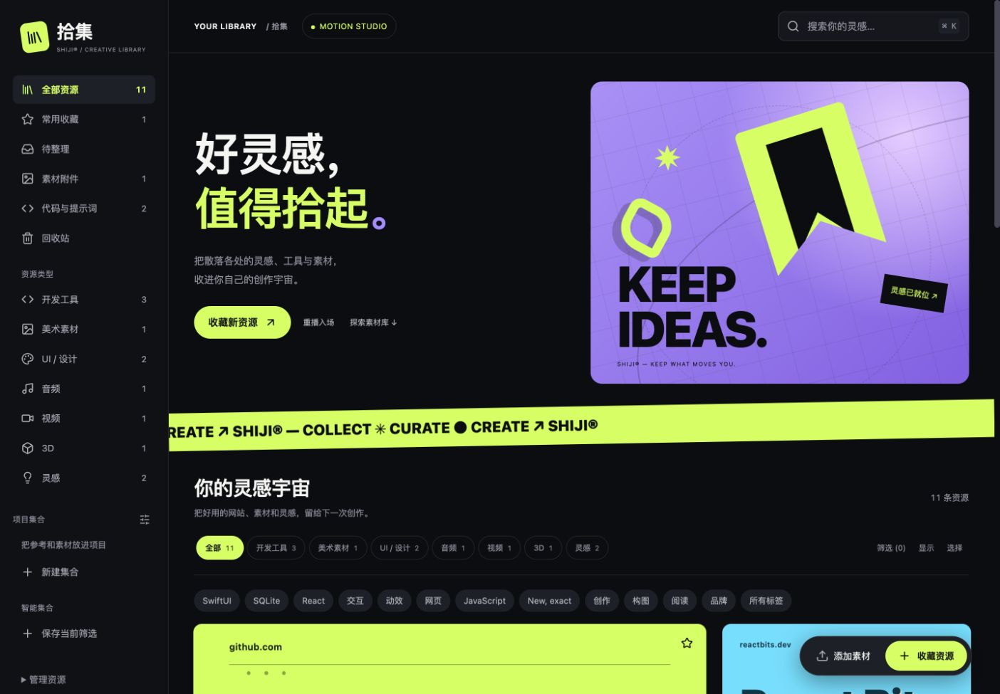
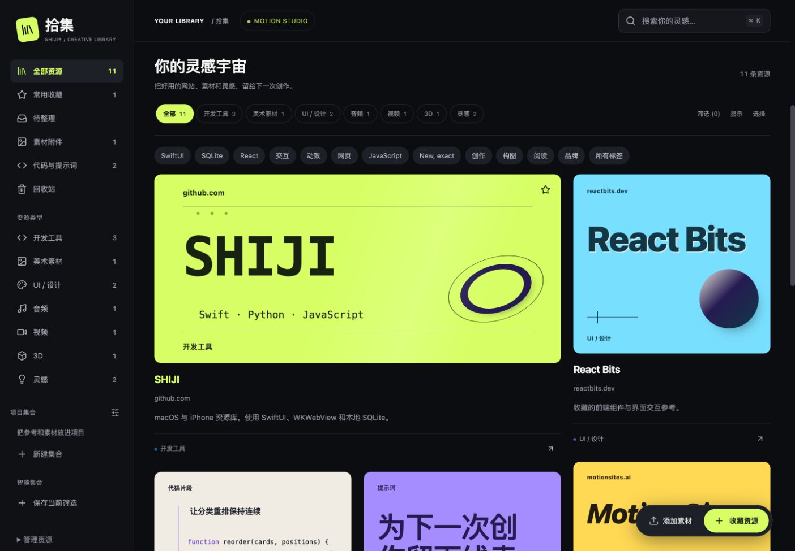
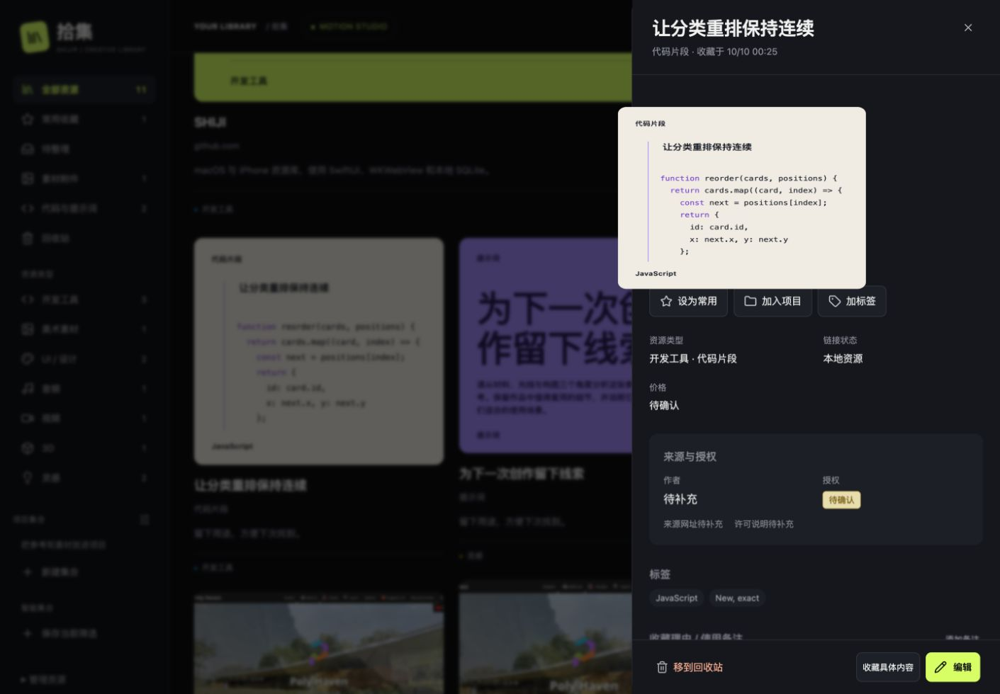
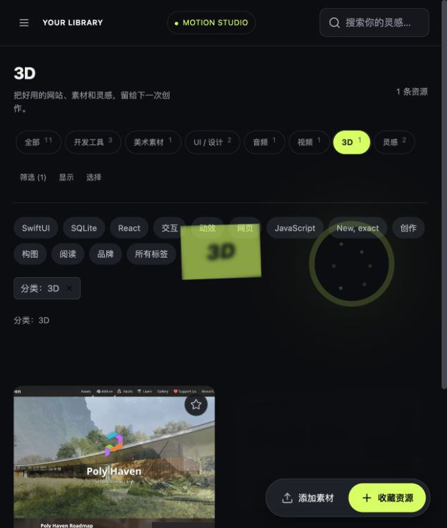
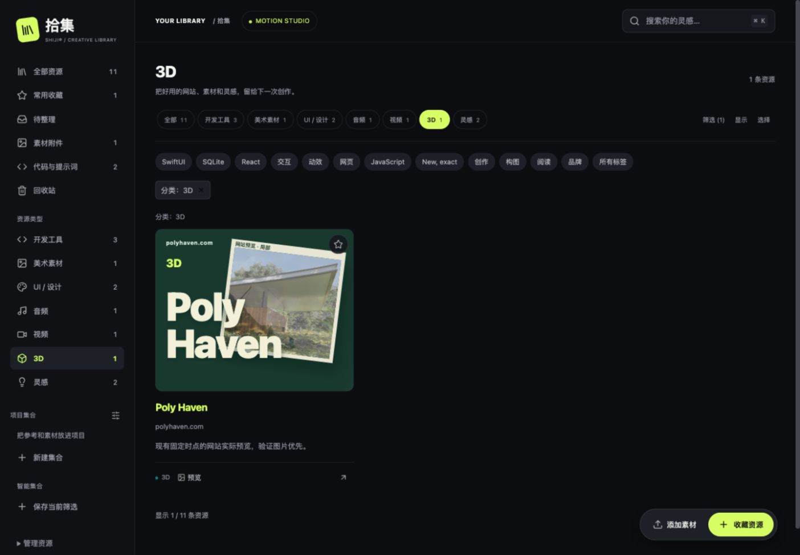
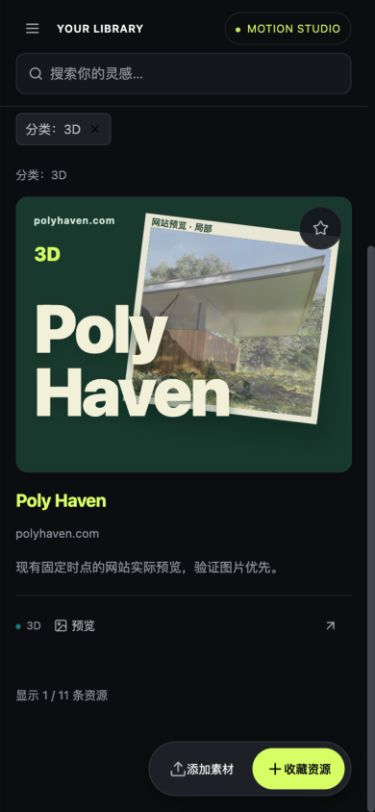
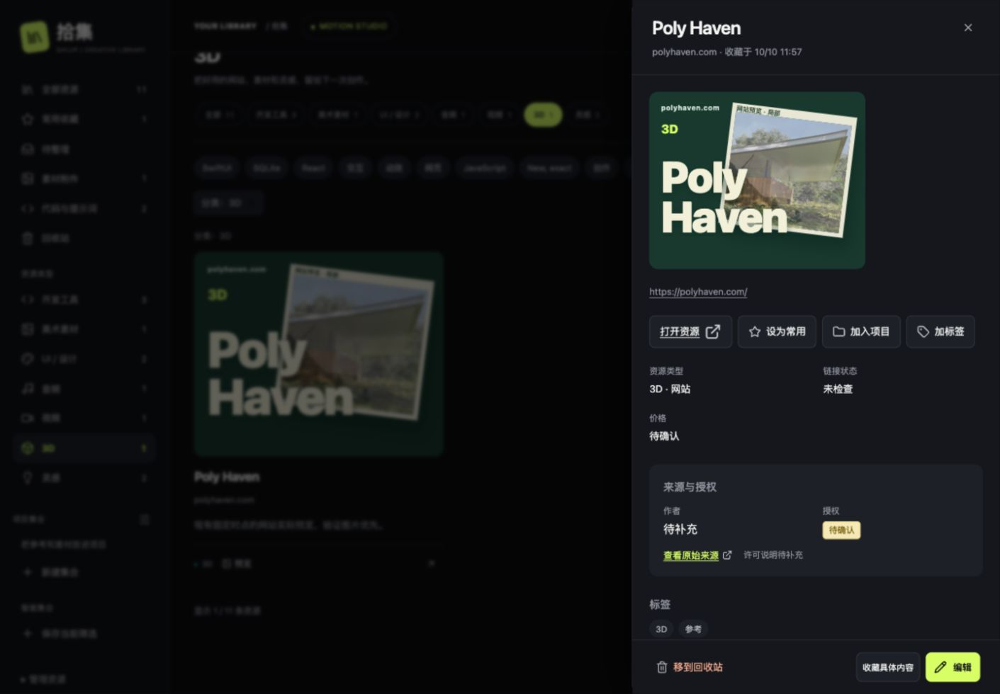

# SHIJI V3 Beta Foundation — 集成报告

2026-10-10。当前状态：桌面与核心数据链路通过集成验收；原生 iPhone 运行截图及 Share Extension 实际验收仍待完成。此分支是 Beta 候选基线，不是已完成全部真机验收的发布版。

## 分支与安全边界

- 工作目录：`/Users/silver/shiji-card-restoration`，复用已有干净的独立 Git worktree。
- 起点：`feat/shiji-art-direction-lab`，`be9e04c31022dc8a241ac91c0beda79479ff7810`。
- 整合来源：`feat/shiji-v2.1-motion-polish`，`4cf4580166a34d8383ca6f248af0a61754b45093`。
- 共同祖先：`cc91d1a54dc0d7e7c858412e65aeb46500fd70ba`；双方各有 5 个独立提交，不能用一边覆盖另一边。
- 新分支：`feat/shiji-v3-beta-foundation`。合并提交 `67cad08` 保留两个来源为父提交；验证提交 `0737949` 补充测试与真实网页截图。
- 开始时两个 checkout 都没有用户未提交修改。原 checkout `/Users/silver/shiji` 仍停在 `4cf4580`，工作树干净。
- 未合并 main，未推送远端。未打开正式数据库、配对凭据，未启动正式端口。
- 生产 Python 服务、存储、备份、同步代码与美术基线相同；SQLite schema 3、ZIP manifest 2 不变，无新增第三方运行时依赖。

## 两条分支的差异与取舍

| 范围 | 美术分支 | V2.1 分支 | 集成结果 |
| --- | --- | --- | --- |
| 桌面卡片 | 八类 Cover Studio 2、真实图片优先、跨列画廊、整卡摇晃/拖拽 | 五类封面、真实字段、控件间距 | 保留八类封面、真实图片、稳定 ID/布局/整卡手势；只取独立控件样式 |
| 详情 | 复制真实封面、隐藏目标避免双影、清理代理 | 更短的连续转场与取消逻辑 | 保留完整封面，560ms 交接，取消/完成后恢复目标；代理禁用交互且移除事件属性 |
| 动效 | 品牌开场、Hero 连续运动、整卡弹性、唯一 Bits 布局系统 | 搜索聚焦、弹窗出入、后台清理与较短重排 | 复用原 Motion/Bits；新增第二套 FLIP/Tilt 的数量为零 |
| 原生 iPhone | 品牌 Hero、SwiftUI 数据/同步/预览 | 真实字段卡片、safe-area 收藏层、大字号分支、扩展诊断 | 整合原生源码与测试；保留 Hero；未将 HTML 搬入 SwiftUI |
| 12 张美术母版 | 独立 Art Direction Lab、真实 V3/V5 参考、Poly Haven 修正 | 无对应系统 | 原样保留，不把固定 12 条记录的手工艺术映射扩展成通用生成引擎 |
| 测试/证据 | 202 Python、40 Node 组、原生核心 | 封面和动效回归、原生回归、历史截图 | 翻译失效的旧封面选择器，保留真实业务断言，补 HTTP 跨层测试和新截图 |

初次整合 `67cad08` 保持 `app.js`、`shiji-v2.js`、`shiji-v2.css` 与美术基线一致。后续 `2622548` 按用户指出的遗漏接入已认可的 Poly Haven 摄影封面，修改这三个文件的封面呈现；大 Hero 的 HTML、尺寸与品牌动画保持不变。12 张 Lab 母版仍然可以单独评审，其文件未被改写。

## 五处冲突处理

| 文件 | 处理与理由 |
| --- | --- |
| `desktop-app/DESIGN.md` | 保留美术规范，补充 V3 整合说明；不把旧五类封面规范当成最终系统 |
| `desktop-app/static/app.js` | 采用美术版本，保留卡片内层 motion surface、资源 ID、跨列属性、封面失败回退与业务事件 |
| `desktop-app/static/shiji-v2.js` | 采用美术版本，保留八类生成封面、内容解析和稳定构图 |
| `desktop-app/static/resource-bits.js` | 保留整卡手势与瀑布流所有者；取 V2.1 重排/进退场时长；合并为一个 visibility handler，隐藏页面取消待执行帧 |
| `desktop-app/static/shiji-v2-motion.js` | 整合弹窗、搜索与取消逻辑；详情继续复制真实封面并隐藏目标，避免双影；共用安全代理复制函数 |

额外处理：缩减 `shiji-v21.css` 为独立搜索、详情、弹窗、控件与恢复提示样式。删除其中会覆盖美术封面和画廊的规则，避免自动合并后出现无文本冲突的视觉退化。

## 实际改动文件

生产桌面文件：`DESIGN.md`、`static/index.html`、`static/resource-bits.js`、`static/shiji-v2-motion.js`、新增 `static/shiji-v21.css`。

原生文件：`mobile-app/App/ShijiApp.swift`、`Shared/Library.swift`、`ShareExtension/ShareViewController.swift`、`Tests/main.swift`，及对应 README/DESIGN/设计侧记。根 README 也保留来源分支的说明。

桌面测试：`test_motion_studio_effects.js`、`test_v21_covers.js`、`test_v21_motion.js`、`test_v3_motion.js`、`test_v3_foundation.py`、`v3_resource_contract.cjs`。

本轮资料：`docs/shiji-v3-beta/SPEC.md`、本报告、`qa/run.py`、`evidence/`、`docs/superpowers/plans/2026-10-10-shiji-v3-beta-foundation.md`。V2.1 历史报告、QA 和证据随其历史保留，不能当成本轮新验收结果。

## 自动化验证

命令在隔离 worktree 执行；各测试使用临时目录。Node 测试复用已有 jsdom 开发依赖，没有安装运行时依赖。

| 检查 | 美术基线 | 集成后实际结果 | 日志 |
| --- | --- | --- | --- |
| `cd desktop-app && python3 -m unittest discover -s tests` | 202 通过 / 27.128s | 205 通过 / 27.748s | [Python](evidence/integrated-python.log) |
| `cd desktop-app && NODE_PATH=/Users/silver/shiji/desktop-app/node_modules node tests/run-node.cjs` | 40 组通过 | 43 组通过 | [Node](evidence/integrated-node.log) |
| `cd mobile-app && python3 Tests/run.py` | 通过 | Swift 原生核心与真实桌面 ZIP 互通全部通过 | [Swift](evidence/integrated-swift.log) |
| `cd mobile-app && python3 Tests/sync_integration.py` | 本轮集成专项 | 真实 URLSession/HTTPS 同步通过 | [同步](evidence/integrated-sync.log) |
| `cd desktop-app && python3 desktop/build.py` | — | macOS app 构建与签名成功 | [macOS](evidence/mac-build.log) |
| iOS Debug arm64 模拟器 `xcodebuild` | — | BUILD SUCCEEDED | [iOS 完成日志](evidence/ios-build-result.log) |
| `python3 Tests/check_bundle.py <QA-build>/Shiji.app` | — | App/Share App Group 一致，资源与图标检查通过 | [Bundle](evidence/bundle-check.log) |

V3 动效回归在整合前运行失败（710ms 旧交接，未采用 V2.1 560ms）；整合后通过。同时检查真实标题/内容代理、隐藏回退不被复制、连续打开只有一个代理、关闭清理目标、弹窗关闭再打开、Calm 与后台暂停/恢复。[实际 RED 日志](evidence/v3-motion-red.log)。

新增三项 HTTP 测试用真实 `Handler`、`Store`、SQLite、临时附件和 loopback 随机端口，验证：

1. 收藏先持久化；离线元数据失败仍保留收藏；旧元数据请求不能覆盖手动标题/备注/标签；通过真实附件接口保存封面并校验字节；真实 HTTP 记录进入现有 Node 搜索、分类、常用、精确逗号标签和封面模型；详情与内容转义正确。
2. 真实 ZIP 的 manifest 2 和附件字节；预检/取消不改库；确认恢复保持 ID/标签/附件；schema 3；票据不可重复使用。
3. 跨来源写请求被拒绝，资源状态不变。

HTTPS 同步通过临时电脑目录、新建测试证书与配对状态、临时 Swift 客户端执行：首次联合、双向新增与附件、逗号标签、显式冲突、错误证书 pin 拒绝、同步期间新收藏保护。**这是协议/客户端集成验证，尚不是两台真实设备的同 Wi-Fi 验收。**

## 实际运行网页验收

`python3 docs/shiji-v3-beta/qa/run.py --count 11` 创建临时 Store，在本次 `127.0.0.1:59266` 运行原产品页面。另建临时空库和 1000 条数据服务，分别在 60576、60579；端口每次由系统分配，均非正式服务。记录为明确的 QA 自写内容及既有真实网址/仓库图片；未使用 Demo 数据替代正式业务。

- Hero 保留大标题、紫色舞台与动态绿横幅。
- 画廊保留跨列封面、真实代码/Prompt；本地图片与实际网站预览优先；不可用封面回退。
- 搜索 `New, exact` 得到代码记录；分类开发工具得到 3 条；详情保留完整代码与逗号标签。
- UI Quick Capture 保存 `https://example.com/shiji-v3-beta-qa` 后关闭弹窗，计数从 11 到 12；随后独立读取 HTTP 确认真实资源存在且 ID 保留。
- Calm 模式实际切换；空库显示正确开始引导。
- 1000 条持久化记录的首批 DOM 卡片数为 60；搜索 `QA 0999` 得到 1/1000。
- 390×844 手机网页、768×1024 平板网页及 1440×1000 桌面布局截图；桌面与手机网页未发现水平溢出。网页响应式截图不等于原生 iPhone 截图。
- 浏览器 viewport 覆盖已恢复。没有用这些静态截图宣称 60 FPS 或原生交互已经通过。

更多实际截图：[搜索](evidence/desktop-search.jpg)、[分类](evidence/desktop-filter.jpg)、[Calm](evidence/desktop-calm.jpg)、[收藏结果](evidence/desktop-capture.jpg)、[空库](evidence/desktop-empty.jpg)、[1000 条](evidence/desktop-1000.jpg)、[手机网页 Hero](evidence/mobile-web-hero.jpg)、[手机网页画廊](evidence/mobile-web-gallery.jpg)、[平板网页](evidence/tablet-web-gallery.jpg)。

## 尚未解决的问题与验收界限

1. **原生 iPhone 本轮截图待完成。** CUA 两次尝试：先无可用窗口，后确认 Mac 锁定且无法自动解锁。已请求解锁并打开 QA 模拟器；未把历史 V2.1 截图或手机网页伪装为当前原生结果。iPhone 原生视觉、safe-area 收藏层、大字号、QuickLook/分享等运行验收仍需可访问的 QA 模拟器/设备。
2. **Share Extension 空白页没有宣称已修复。** 只整合 V2.1 已完成的布局诊断与过期会话保护、编译/App Group 测试；扩展真实启动及 URL/文本/图片/错误恢复仍需要原生运行验收。
3. macOS 原生壳构建通过；本轮桌面截图来自产品的实际网页界面，尚未在隔离原生 WKWebView 壳内再次验收。
4. 本轮未测量新的帧时间分布，不复用历史指标声称当前分支 60 FPS。生产布局仍有分页，已有性能/布局测试通过。
5. 12 张手工 Lab 母版是保留的美术基准；通用生产封面仍是八类 Cover Studio 2。Poly Haven 的已认可摄影封面现已实际接入。其他母版尚未接入，将其提炼成任意真实资源的内容驱动生成系统仍是后续任务。

下一步仅补原生运行证据及独立审查中发现的实际集成问题；不增加新功能，不发布 main。

## 独立最终审查

独立只读审查完成，范围为 `be9e04c..0737949`、两个来源差异及运行证据。未发现本轮新增 Critical 或 Important 缺陷；审查者独立复跑五组相关 Node 测试和三项 HTTP 工作流测试，均通过。保留美术 renderer、Hero、稳定 ID、唯一整卡手势所有者，动效代理/清理及数据格式边界得到确认。审查认可其作为本地集成候选基线，不等于原生完整验收。

审查指出的已有重要问题：Share Extension 空白页仍未完成实际验证；保留为发布前待办。Minor：代码详情截图为转场中间帧；已明确标注，仍需补稳定代码详情截图。后续 Poly Haven 详情截图另行等待代理消失后拍摄，不能替代代码详情的证据。

审查拒绝对没有实际运行证据的原生视觉、最大字号、收藏层、导航/动效、扩展根因与修复、真机/旧系统、持续 FPS 和后台实际渲染作通过判断。处理决定：全部保留待验证，不使用构建、协议测试或手机网页代替原生验收。后续 `2622548` 的封面修正由下述回归与实际截图验证，未另行重复该独立审查。

## Poly Haven 已认可封面的接入修正

用户在真实预览中指出 Poly Haven 仍显示整页网站截图。原因是初次集成只保留了 Lab 中已认可的摄影版式，没有将它接到实际画廊和详情；这是集成遗漏。`2622548` 修正这一点，不改资源、数据库或大 Hero。

`shiji-v2.js` 增加现有模块内的摄影封面呈现，`app.js` 让画廊与详情复用，`shiji-v2.css` 实现森林绿底、奶油色标题、倾斜纸张和真实建筑局部。只处理已有 `previews/polyhaven.jpg`，用户手动封面和其他真实预览保持优先；资源名、域名、类别仍取真实保存字段。失败隐藏整个摄影层并回退，稳定卡片复用失败图片后仍正确回退；没有新增 FLIP/Tilt 或外部 API。

实际新增/修改：`desktop-app/static/app.js`、`shiji-v2.js`、`shiji-v2.css`、`desktop-app/DESIGN.md`、`tests/test_photo_cover.js`、`tests/test_cover_design.js`，及本报告和截图日志。

回归：Node **44 组通过**、Python **205 项通过 / 30.083s**、隔离 HTTP **3 项通过 / 1.744s**、macOS 重新构建与签名成功。新增测试先在旧呈现上失败，再验证真实字段/转义、手动封面优先、加载失败/恢复、稳定 ID 图片复用。无原生源码改动，不将此 macOS 构建称为新的 iPhone 运行验收。

日志：[Node](evidence/polyhaven-node.log)、[Python](evidence/polyhaven-python.log)、[HTTP](evidence/polyhaven-http.log)、[macOS](evidence/polyhaven-mac-build.log)。

当前可查看的隔离预览：`http://127.0.0.1:50461/`，临时数据目录 `/var/folders/zf/9x8vcjy9091gxc3tdsz79_lm0000gn/T/shiji-v3-beta-qa-hez60zt4`；前文 59266 等端口为先前验收记录。

## Native macOS preview startup (2026-10-10)

The latest signed build was copied into a separate Shiji V3 Beta Preview.app and launched through native UI tools. Its data is a read-only SQLite snapshot of the disposable QA library plus QA attachments. No formal data or credentials were copied. A separate bundle identifier, no formal URL scheme, and fixed LSEnvironment isolate this copy at port 52524. Native AX confirms WKWebView `127.0.0.1:52524/?desktop=1`, 11 QA records and the approved Poly Haven photographic cover fields. The desktop-status endpoint returns the matching native instance; app.js, shiji-v2.js and shiji-v2.css in the bundle match source bytes.

App: `/var/folders/zf/9x8vcjy9091gxc3tdsz79_lm0000gn/T/shiji-v3-native-preview-4ie6nie0/Shiji V3 Beta Preview.app`. Disposable data: sibling `data` directory.

Runtime limit: AX launch/filter/detail actions work, but window coordinate input reports no available windows and the tool cannot bring the app to the foreground. Background screenshots remain mid-transition; they are retained alongside the temporary app in `evidence`, not accepted as settled visual or complete motion evidence. This verifies native startup and bundled code only. Native iPhone and Share Extension acceptance remain pending.
