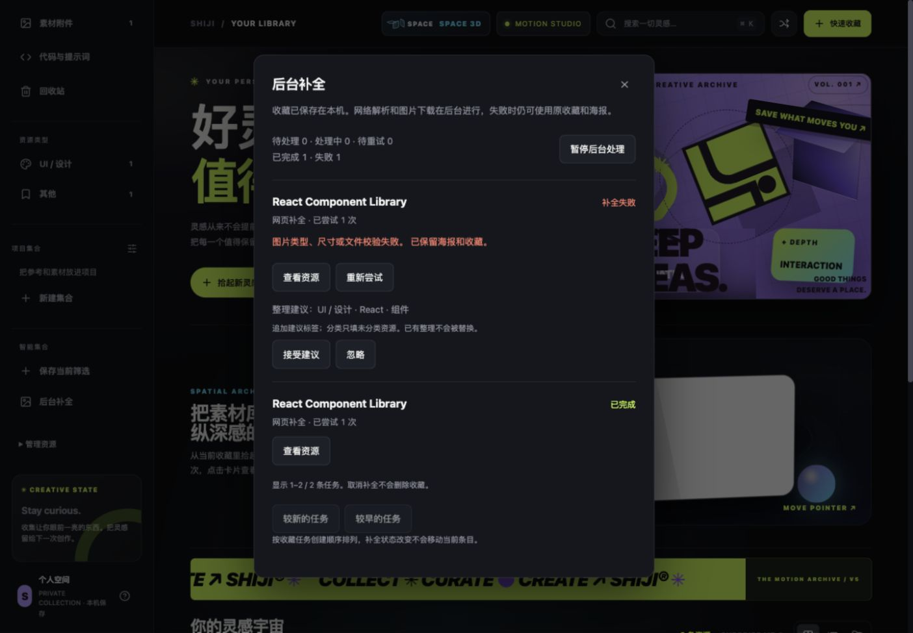
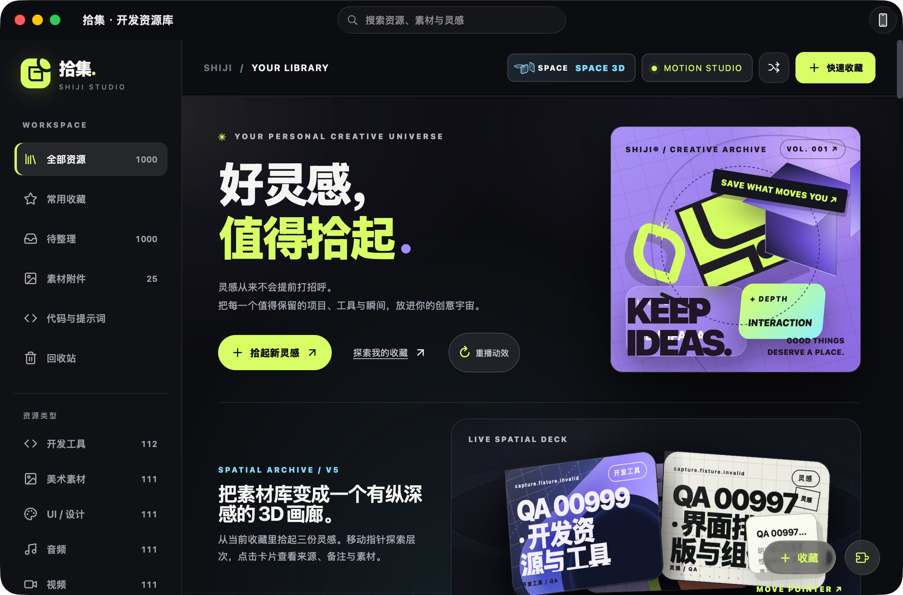

# SHIJI V6 Smart Capture Engine 交付报告

交付整理：2026-10-15。实际代码已在 `feat/shiji-v6-smart-capture` 实现，保留 V5 UI；这是可继续验收的功能候选，不是已完成全部设备验收的正式发布。

## 基线与安全

开始时 `/Users/silver/shiji-card-restoration` 工作树干净；获取远端后，本地与 `origin/feat/shiji-next-capture-organize` 同为 `de06972`。基于它创建独立 V6 分支，未覆盖未提交内容，未操作正式资源库、正式端口或用户配对凭据。

已用 Git 祖先检查确认：V5 Spatial `9d013bc` → Stable `d7a6749` → V5.1 `3d1928f` → V5.2 `b6c2913` → Next `de06972` → V6。Next 起点比 main 多 41 个提交。GitHub 实查目前只有 [Draft PR #1](https://github.com/SilverLi123/shiji/pull/1)，仍 open、未合并，Stable → V5 Spatial；没有把它误认为所有 Next／V6 已进入 main。本轮不推送、不合并 main，也未改写历史大文件。

## 实际完成的模块

| 模块／文件 | 变更与验证 |
| --- | --- |
| `capture_jobs.py`、`storage.py` | 可选本机任务表、原子保存入队、去重、单 Worker、租约、七种状态、持久暂停／重试／取消、恢复和版本保护。 |
| `preview_jobs.py` | 原有历史封面补全共用调度器；默认关闭／限速／暂停保留，状态不再只在内存中；关闭时查看状态不产生虚假任务。 |
| `capture.py`、`capture_images.py` | 公网页元数据、canonical 提示、本地真实图片校验；SSRF／重定向／响应大小边界保持，网络不持全局资源锁。 |
| `capture_rules.py` | 独立可扩展本地规则，输出规范分类／标签建议；用户接受或忽略，不静默整理。 |
| `server.py` | 原保存、enrich、clip 接入同一业务；新增任务 GET／POST，支持历史分页；扩展收藏不再等远程图片下载。 |
| `static/quick-capture.js`、`app.js`、`capture-tasks.js/css`、`index.html` | 保留原不确定请求核对；轻量入口、真实任务反馈、错误恢复、分页、建议审核、键盘焦点和读屏名称。未改 V5 海报／动画所有权。 |
| Python／Node 回归与 `qa/` | 真实临时 Store／HTTP API／Fixture、并发保存、编辑竞态、失效租约、备份、100 URL 强杀恢复及大库测量。 |
| `.github/workflows/tests.yml` | 继承 Python／Node／Swift 检查，加入 V6 分支和独立 100 URL 恢复 Job；只上传安全日志制品，保留 7 天。尚未推送，因此不声称远端 CI 已运行。 |

架构开发前审查见 [ARCHITECTURE.md](ARCHITECTURE.md)，接口见 [API.md](API.md)，迁移／回退／同步兼容见 [COMPATIBILITY.md](COMPATIBILITY.md)。schema 3、ZIP manifest 2、iPhone App Group JSON 与同步协议均未改变；没有新增第三方运行时依赖或 AI 服务。

## 修复与独立审查

- 捕获开始后手工编辑、取消、暂停、删除及删除后撤销，都能阻止迟到写入；手动重试不能重新授权覆盖人工整理。
- 修复默认关闭预览时状态轮询仍产生任务的问题，1000 条 QA 库的活动任务从虚假的 1075 修正为真实 975。
- 独立审查复现无 PLTE 的索引 PNG、零帧分量／空扫描 JPEG 被接受；新增失败测试后补结构验证，真实 JPEG 和 PNG 继续可用。
- 修复补全自身版本推进后再次收藏可能新建任务的问题，enrich 复用原任务 ID／状态，保留人工编辑保护；真实 API 回归通过。
- 修复仅列出最近 30 条导致旧建议／失败任务不可操作；增加真实 API 分页、稳定创建顺序和过期轮询响应隔离，实际浏览到 31–60／1000。
- 修复非封面 asset 下载后不置 dirty、可能漏自动快照；真实 Store 快照回归证明新增附件触发下一次快照。
- 独立 UI 复核发现异步操作禁用按钮重绘丢焦点、对话框缺读屏名称；保留操作锚点与已启用焦点，补 `aria-labelledby`。实际 Enter 暂停后焦点在恢复、恢复后回到暂停；成功和失败回归都覆盖。

三项代码审查问题和上述 UI 修复已获有边界的独立复查通过，不代表整个原生产品认证。既有设计文档／sidecar 漂移只记录，未顺带修复。

## 测试结果与证据

| 检查 | 实际结果 |
| --- | --- |
| 起始 Python／Node | 208 项／52 组通过。 |
| 最终 Python `python3 -m unittest discover -s tests` | **245 项通过**，69.921 秒，`/tmp/shiji-v6-delivery-python-final.log`。 |
| 完整 Node `npm test` | **53 组通过**，`/tmp/shiji-v6-delivery-node.log`；追加历史页竞争／焦点用例单独通过，`/tmp/shiji-v6-final-pager-focus.log`。 |
| Swift core／真实 ZIP 桌面交换 | 通过，`python3 mobile-app/Tests/run.py`，`/tmp/shiji-v6-swift.log`。 |
| Swift HTTPS 双向同步 | 通过，`python3 mobile-app/Tests/sync_integration.py`，含附件、冲突、错误证书 pin、迟到采集保护，`/tmp/shiji-v6-sync.log`。 |
| macOS 构建与本地签名 | 通过，`python3 desktop-app/desktop/build.py`，`/tmp/shiji-v6-delivery-macos-final.log`。 |

中间一次完整 Python 238 项运行中，原有 Swift QR 二进制以 SIGTRAP 退出；单项复跑、补 stdout/stderr 诊断后的单项及两轮完整回归后来均通过。没有证明唯一根因，不能抹去该失败或断言已修复。保留 `/tmp/shiji-v6-final-python.log`、`/tmp/shiji-v6-phone-sync-rerun.log`、`/tmp/shiji-v6-phone-sync-diagnostic.log`；测试只增加失败输出，不放松断言。

覆盖正常／重复／无效 URL、元数据完整／缺失、DNS／超时／私网重定向、错误图片、分类建议、相同 URL 并发保存、标题／分类／封面／URL／删除竞态、暂停／取消迟到响应、租约重启和普通 Worker 处理异常。所有资源均走现有 Store／API，不使用 Demo 数据模型。

## 100 URL 中断恢复

执行 [recovery_100.py](qa/recovery_100.py)：100 个确定性 URL＋15 次重复收藏；真实 HTTP Fixture 模拟成功、空元数据、坏封面、私网重定向、503、DNS 离线及超时。中途手工标题／分类／标签／封面和运行中编辑，再真实 SIGKILL 后端并重启同一临时库。没有缩短 120 秒租约或生产重试间隔；仅 Fixture 网络期限缩为 0.15 秒以确定性触发超时。

调度、图片及分页修复后的第三轮耗时 136.951 秒，重启到收敛 120.885 秒。结果见 [recovery-100.json](evidence/recovery-100.json)：100 个资源、100 个任务、37 个验证通过且引用正确的附件；46 completed、50 预期 Fixture failed、4 因人工编辑 skipped，所有活动／残留租约归零，无重复资源／封面／孤儿附件，人工编辑保持。失败数是测试注入结果，不是线上成功率。

## 运行界面与性能

实际浏览器完成保存→元数据→本地 PNG→建议接受；暂停期间可立即保存，取消不删收藏，重试／恢复正常，无效封面保留元数据和海报。最终桌面／手机宽度截图和独立 UI 对照见 [UI.md](UI.md)。手机截图是响应式网页，不是原生 iPhone。

最后的已完成任务复用修复另由真实 API 回归与最终完整套件验证；100 URL 压力脚本未调用该 enrich 兼容入口，不将旧压力结果冒充这一新增路径的证明。

千条／五千条后端原始样本、浏览器实际输入延迟和长帧见 [PERFORMANCE.md](PERFORMANCE.md)。没有将 rAF／transform 或构建通过等同于原生 60 FPS。

## 尚未完成的验收与下一步

1. 原生 QA App 已确认 Hero、加载、1000→1 搜索及任务数量 975；原生任务弹层点击仍被界面工具无可用窗口阻断。解锁置前后截图／搜索成功，不能据此补算弹层验收通过。尚无本轮原生帧／CPU／WebContent 内存结论。
2. 保留 V5.2 首次详情约 243–249 ms 长帧风险；浏览器 5000 条也仍有长帧和全量检索成本。
3. Chrome／Edge 真实安装后完整采集闭环、实体 iPhone 分享／失败恢复／同步仍需实机；现有 API／模拟器证据不替代这些项目。
4. 图片验证不等于所有格式的完整像素解码；文件发布与 SQLite 跨文件崩溃切点、任务历史长期保留／清理策略仍可继续专项验证。任务取消保留历史，不宣称已实现自动历史归档。
5. favicon 目前保存公开地址；canonical 为解析提示，未新增同步字段；没有登录抓取、云 AI 或隐式改分类。
6. Search 2.0 先设计可重建 FTS／中文索引及全选语义；Cover Studio 先审批跨 SQLite／Swift JSON／ZIP／同步的用户偏好兼容方案。当前任务表可复用调度约定，不能直接作为用户偏好权威数据。

大录屏、trace、SQLite 和一次性凭据留在临时 QA 目录，不加入新提交。既有 39 MB 历史证据未迁移或重写 Git 历史；新 CI 恢复日志使用短期 Artifacts。当前工作只形成候选基线，后续合入主线需用户批准与真实设备验收。
