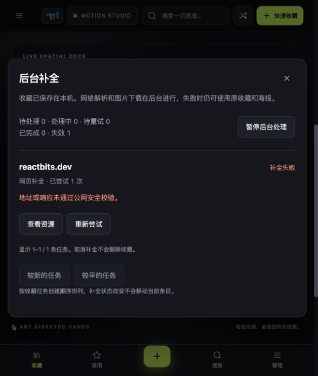
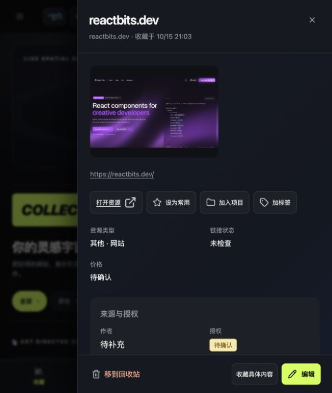
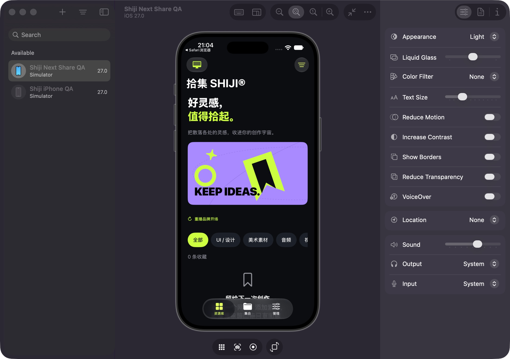
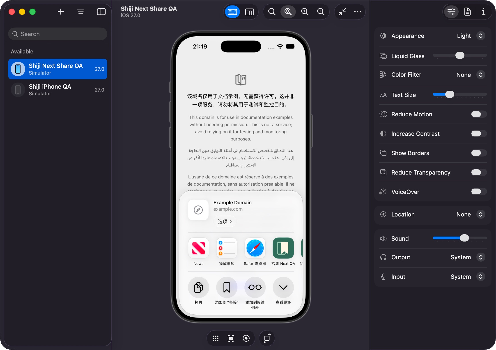

# V6.1 — Capture Everywhere 交付与验收记录

2026-10-15。基线 `c393671`，独立分支 `feat/shiji-v6.1-capture-everywhere`。本轮交付功能候选，真实扩展安装／Safari 最后保存操作尚无完成证据，不标记为正式发布。未推送、未合并 main；没有操作正式资源库、端口或配对凭据。

## 实际代码

| 提交 | 内容 |
| --- | --- |
| `16dcc63` | 目标、兼容边界和分模块实施计划。 |
| `e1aeba9` | 手机同步的新网站／URL 变化接入 V6 单 Worker；资源、附件、任务及同步回执同事务。删除撤销旧任务，手动字段保留。新增 5 项真实 Store／HTTP Fixture 回归和 Swift HTTPS 采集回读。 |
| `796a3dd` | 本机 clip 回执表、能力探测、认证状态查询和原子采集回执。重复请求保留后续编辑、回收站及缺失记录；旧客户端仍可调用原接口。6 项回归。 |
| `66f4298` | 扩展持久待发送、冻结页面和截图、回执优先重试、配对指纹、alarm 恢复、轻量待发送列表。真实 Node 进程→HTTP→Store 中断恢复测试。 |
| `5869c7a` | 独立审查两项存储边界修复，分别有 RED→GREEN 回归。 |

主要文件：`desktop-app/mobile_sync.py`、`storage.py`、`server.py`、新增 `capture_receipts.py`；`browser-extension/outbox.js`、`clip-transport.js`、`background.js`、`popup.js/html/css`、`manifest.json`；对应 Python／Node／Swift 测试。界面继续使用现有 V5 Hero、Spatial Deck、纯封面画廊和 Motion Studio。

新增接口和数据恢复说明见 [API.md](API.md)。SQLite schema 3、ZIP manifest 2、手机同步协议 1 均保持；可选本机回执不进入资源交换和同步权威内容；无新增第三方运行时依赖。后续 Search／封面偏好没有混入本次提交。

## 独立审查和修复

独立只读审查无 Critical、两项 Important、无 Minor。原有回执重放和同步版本保护未发现额外实质问题。

1. **接近容量上限时离线条目锁死。** 原先允许写入接近 8 MiB 的内容，随后写入中文错误信息可能超过自定上限，遗留 sending，重试／移除被拒。测试在仅剩 30 字节时复现失败；修复在准入时每条预留 2048 字节、限制错误文本，允许旧队列状态恢复，发送循环已结束时允许移除残留标记。真实网络在途仍禁止移除。
2. **存储配额错误使弹窗无响应。** 原先错误处理再次写 lastCapture，二次配额失败阻止 reply。测试先复现超时和未处理拒绝；修复使反馈写入 best-effort，失败仍返回“这次内容尚未保存”，并尝试显示错误徽标。

失败日志：`/tmp/shiji-v61-review-outbox-red.log`、`/tmp/shiji-v61-review-quota-red.log`。修复后针对性测试和完整套件通过，没有放松安全／并发断言。

## 自动化与构建

| 检查 | 真实结果／日志 |
| --- | --- |
| 开发前基线 | Python 245、Node 53 通过；`/tmp/shiji-v61-baseline-python.log`、`/tmp/shiji-v61-baseline-node.log`。 |
| 最终完整 Python | **257 项通过**，81.949 秒；`/tmp/shiji-v61-python-final-rerun.log`。 |
| 最终完整 Node | **55 组通过**；`/tmp/shiji-v61-node-final.log`。 |
| Swift 核心、共享持久化和真实 ZIP 交换 | 通过；`/tmp/shiji-v61-swift.log`。 |
| 真实 Swift HTTPS 同步 | 通过；`/tmp/shiji-v61-sync-final.log`。包括新 URL 从手机上传→电脑现有队列解析→本地 PNG→Swift 手机库回读，标签及备注不变；原有冲突、错误 pin、迟到采集继续覆盖。 |
| 真实扩展模块跨进程 HTTP | 通过；`/tmp/shiji-v61-extension-http.log`。独立 Node 进程先离线暂存，服务启用后真实保存但丢弃响应，编辑并移入回收站，重开 Store，再由另一 Node 进程核对回执，无重复资源／附件或复活。它不是 Chrome 安装验收。 |
| macOS App 构建及 ad-hoc 签名 | 通过，包含最终扩展修复；`/tmp/shiji-v61-macos-build-final.log`。 |
| iOS Simulator App＋Share Extension 构建／App Group／资产检查／安装 | 通过；`/tmp/shiji-v61-ios-signed-build.log`。独立 app/group ID，安装到命名 QA 模拟器；不代表分享保存通过。 |

中间一轮完整 Python 的既有 `test_status_recovery_and_dense_qr` 以 SIGTRAP 失败，错误来自 Vision ANE 推理模型文件加载（`Could not build inference plan`）。日志 `/tmp/shiji-v61-python-final.log` 保留。原断言不变，单项 `/tmp/shiji-v61-vision-rerun.log` 随后通过，再跑最终完整 257 项通过。没有证明该系统失败的唯一根因，不宣称本轮修复了 Vision。

QA 构建命令最初使用无签名通用二进制，旧包检查器要求 arm64 并需要嵌入模拟器权限；随后按 `mobile-app/README.md` 的已知命令开启模拟器 ad-hoc 签名，App 与扩展实际 App Group 一致并通过。没有修改产品权限或跳过包断言。原始尝试日志也保留。

## 实际运行验收

- 隔离网页 `http://127.0.0.1:59305/`：用真实快速收藏表单保存 reactbits.dev，立即显示 1 条收藏及真实保存反馈。公网解析被现有安全校验拒绝时，资源保留，已有站点预览／海报体系可继续展示，任务给出明确失败原因；从任务面板可打开实际详情。
- Node／DOM 扩展测试实际执行生产后台、队列及 popup 代码，覆盖离线→待发送、网络恢复、状态徽标、错误文字转义、键盘焦点、发送中操作禁用、配对变化、存储配额及大截图边界。不能替代 Chrome／Edge 安装后 alarm 和生命周期验收。
- 隔离原生 iPhone App 已实际启动显示现有 Hero／空库，并能通过语义按钮进入电脑同步页。通过真实 Safari 的页面菜单打开系统分享面板，截图中可见已安装拾集扩展。分享面板的扩展按钮没有可用 AX 子节点；坐标输入仍返回 noWindowsAvailable，无法由工具完成选择／保存。
- 已请用户手动加载独立 QA 浏览器扩展、执行一次收藏；用户回复“行”，尚非保存成功确认。检查时临时库 clip 回执仍为 0，故没有计作通过。
- 已请用户在 Safari 选择“拾集 V6.1 QA”保存；检查时独立 App Group 仍为 0 条资源，故没有计作通过。后续应以 `qa/check_phone.py --require-safari` 及主 App 实际回读确认。
- 无实体 iPhone 在线；没有将模拟器／Swift 核心结果外推为真机通过。没有新的原生帧时间、CPU、GPU 或 60 FPS 结论。

## 尚需完成与后续安排

1. 用户实际加载 QA 扩展后：普通网页、选中文字、图片和截图；App 关闭时待发送；浏览器 Worker 重启／恢复；丢响应核对回执。当前自动化已覆盖业务与跨进程恢复，真实安装项继续待验收。
2. Safari 保存及主 App 回读、系统保存失败再试、重复分享保留手动内容；再做实体 iPhone 与照片分享。QA 工程及只读核对脚本已准备，见 [qa/README.md](qa/README.md)。
3. V5.2 原生首次详情长帧、睡眠恢复和长期内存仍保留专项。本轮没有调整现有视觉或宣称解决性能风险。
4. 传输回执目前长期保留；后续归档需保留去重标记。附件文件发布与 SQLite 跨文件崩溃切点仍属于下一轮稳定性专项。
5. V6.1 跨端验收闭合后，按既定顺序进入 Search & Scale：批量附件读取、增量刷新、可重建全文索引、中文短词与相关性评测，再推进用户封面偏好的持久化与同步设计。

执行决策：用户已明确授权按所提路线开发，因此直接在独立分支逐项实施；本轮限定 V6.1，其余路线单独交付。若该范围判断偏离用户意图，代价是后续版本仍需继续实施，不能把它们算作本轮已完成。审查未覆盖的安装／真机／包检查分别由上述运行证据或未完成项承担；无延期 Minor。
