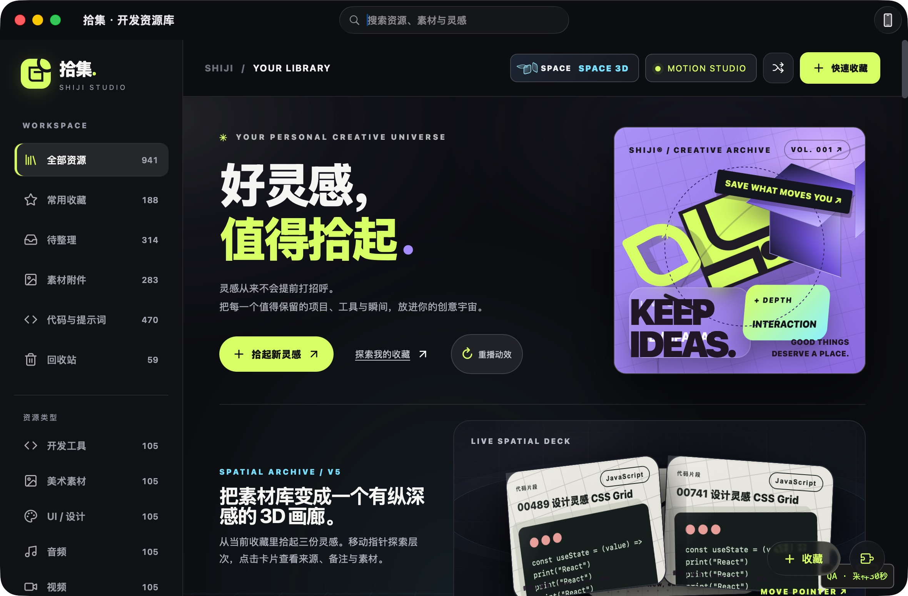

# SHIJI V6.2 — Search & Scale 交付记录

2026-10-16。当前为**已实现、可运行的搜索候选版**，尚不作为全产品50K容量或原生性能发布认证。独立分支 `feat/shiji-v6.2-search-scale`，从远端V6.1 `9433afc` 创建；再次 fetch 后本地/远端V6.1差异0/0。未覆盖原有未提交修改，未推送本分支、未修改/合并 main。所有资源与测试凭据都在新建临时目录，未操作用户正式库或59305等既有服务。

## 已实施模块与提交

| 提交 | 实际变更 |
|---|---|
| d68dd76 | V6.1基线测试、SQLite tokenizer探测、1K/5K/20K/50K原始基线；CI分支过滤改为feat/shiji-v6* |
| 59105da | 可重建全文索引、SQL脏记录触发器、附件批量读取、Query API、事务内版本校验、差分/HTTP测试 |
| 89b267e | 文档与FTS分阶段构建、批事务连接复用、完整精确回退、运行时损坏诊断、媒体分页/相关资源/组织投影、兼容回归 |
| 3af3830 | V5迁移为摘要分页、搜索取消与高亮、按需完整详情、跨页全选、旧响应竞态修复与慢初始化保护 |
| 4453e08 | 空结果与空库/空项目区分；真实API/UI测试新增Enter、Esc与空搜索回归 |
| CI模块提交 | CI增加macOS实际打包/签名构建步骤，未宣称远端候选Actions已通过 |
| 本报告所在提交 | 实测工具、截图、原始数据、兼容/API/性能文档 |

主要业务文件：`search_text.py`、`search_index.py`、`resource_query.py`、`storage.py`、`server.py`、`projects.py`，前期已改`mobile_sync.py`/`backups.py`的附件读取。前端：`app.js`、`resource-query.js`、`query-integration.js`、`index.html`，以及现有filter-editor、gallery、similar、organizing、tag/project-picker、quick-capture和少量搜索样式。未增加运行时依赖或新的FLIP/Tilt控制器。

[架构与兼容](ARCHITECTURE.md) · [API与交互](API.md) · [完整性能实测](PERFORMANCE.md) · [复现工具说明](qa/README.md)

## 搜索与数据安全

- 现有资源/附件/项目继续作为权威数据。SQLite user_version3、ZIP manifest2、iPhone App Group JSON、同步协议1、采集任务及回执保持兼容。
- 派生search_docs保存完整检索范围；可选FTS5使用应用生成的Unicode单字/双字ASCII tokens，再逐词精确验证。中文短词、英文/短语、大小写、混合输入、代码符号与AND查询不依赖平台中文分词。
- 新增/编辑/软删除/恢复/导入/同步/后台补全，均由SQL触发器记录脏ID。旧版本或直接SQLite写入也不会绕过维护。索引不参与同步权威资源交换，可重建与回滚。
- 先准备完整文档，再后台构建FTS。构建期间使用完整精确查询，绝不把部分索引结果当完整答案。破损诊断先核验权威数据，只修复派生数据。
- 列表默认60条摘要，支持精确匹配总数、复合过滤、相关性与稳定排序、游标及按ID完整详情。全选获取完整匹配ID，批量写入在同一事务检查库版本，过期响应/选择不会误应用到新范围。
- 摘要禁止回写为完整资源；详情/编辑先取完整原文，保持代码、备注和附件。现有备份/采集/同步/扩展API保留。

## 实际发现、复现与修复

| 问题 | 复现/定位 | 修复与结果 |
|---|---|---|
| V6.1小数版本分支不触发push CI | feat/shiji-v6-*不匹配feat/shiji-v6.1… | 改feat/shiji-v6*；解析YAML并校验V6/V6.1/V6.2/后续小数版本匹配 |
| 全库读取逐条查附件 | 基线50K full state中N+1读取 | 批量读取附件；同操作P50 8220→1128ms |
| broad FTS查询/构建变慢 | 实际SQL计划重复MATCH；批连接关闭触发WAL checkpoint | rowid候选子查询、FTS驱动访问与连接复用；保留原始样本与冷构建成本 |
| 智能集合条件无法真正移除 | 显式编辑filters后又叠加scope默认条件 | 仅filters缺省时应用默认条件；差分和专项回归通过 |
| 旧筛选结果覆盖新范围 | all→favorite请求→返回缓存all→迟到favorite | 请求key与epoch双重校验，取消旧请求；回归通过 |
| 取消全选后迟到响应重新选中 | select-all/unselect-all请求逆序完成 | 独立selection epoch；结束选择也失效；回归通过 |
| 泛化SQLite错误未触发FTS修复 | 在临时库破坏FTS shadow segment，错误文字为malformed image | 核验权威表后诊断派生索引，安全重建；原资源完全一致 |
| 慢冷启动绕过分页 | 实际50K首次索引超过定时刷新周期，desktopSync提前请求全库 | libraryReady门控；3300ms延迟真实HTTP/JSDOM用例先失败、修复后通过；实际冷页面无全库/回收站下载 |
| 搜索0匹配被当成空资源库 | 分页summary数组为空时用其长度判断全库 | 使用全局counts/projectCounts；实际提示“没有匹配的资源/清除筛选”，真正空库保留首次引导 |
| 详情异步读取与旧点击测试不一致 | 单击后立即断言未等待真实详情HTTP | 等待既有条件一次成功；仍只发送一次点击，不模拟第二次点击 |

独立只读复查对89b267e/3af3830无确认的P1/P2阻塞；上轮三个问题均以回归修复。最后的空状态补丁另有真实HTTP/UI RED→GREEN和完整回归。未以审查代替实际运行验收。

## 测试结果

V6.1开发前：Python257、Node55组、Swift核心/桌面交换、真实Swift HTTPS同步、macOS构建通过。

V6.2最终本地证据：

| 检查 | 真实结果 / 原始日志 |
|---|---|
| 全量Python unittest | **283通过**；`/tmp/shiji-v62-release-python.log`，87.60秒 |
| CI portable/native分区 | **281+2通过**；`/tmp/shiji-v62-delivery-portable.log`、`-native.log`，合计覆盖全部283 IDs |
| Node | **57组通过**；`/tmp/shiji-v62-final-node2.log` |
| Swift核心、桌面交换 | 通过；`/tmp/shiji-v62-final-swift.log` |
| 真Swift HTTPS双向同步/证书pin/迟到采集保护 | 通过；`/tmp/shiji-v62-final-https.log`，一次性证书和临时库 |
| macOS完整编译、打包、ad-hoc签名 | 通过；`/tmp/shiji-v62-shipping-macos.log`，Swift6.4/arm64 |
| Trace工具与缓冲探针 | Python3项/Node通过；`/tmp/shiji-v62-trace-tests.log`、`-probe-tests.log` |
| 120种旧JS/新SQL过滤差分 | 通过，包含项目层级、智能集合、回收站、颜色/附件/日期等真实Store数据 |
| 实际API+整页脚本 | 正常与3300ms慢初始化均通过；60→120分页、空搜索、Enter/Esc、完整10KB代码详情/编辑、全选130条全部整理 |
| 真实备份/导入/手机提交→索引 | 专项通过；旧格式、完整人工备注、原ID、直接同步写入、删除恢复保留 |
| 100 URL真实中断恢复 | **通过**；100资源/100任务，46完成、50预期失败、4人工编辑跳过、37附件一致；真实120秒租约，重启后120.278秒收敛，零运行/重试残留；[结果](evidence/capture-recovery-100.json) |
| 采集/搜索并发 | 1K/5K各20真实任务，19补全+1人工编辑跳过，零丢失；[原始数据](evidence/capture-under-load.json) |
| GitHub Actions | YAML/分支规则及各本地等价命令已检查；增加native实际App构建。**本分支未获推送授权，远端候选工作流尚未运行**，不标记绿色 |

中间回归曾出现原有Vision/ANE QR推断崩溃，未改约束或增大超时；不改源码单独复跑及最终完整回归通过。环境间歇性仍需观察。测试几何桩只用于逻辑，不被计为帧率证明。

## 实测结论和视觉证据

50K总资源/47058活跃资源：默认首批60条约74KB；列表查询P50/P95 4.16/4.92ms，中文41.27/48.14ms。首次无索引需要文档准备约6.5秒，再另有FTS构建成本；不能将热查询数字当首次App或输入响应。真实浏览器宽泛混合搜索仍出现约1秒端到端延迟，详见性能报告。

已实际打开1K/5K/20K/50K V5页面，进行搜索、标签组合、分页、打开完整详情、空库/空搜索、长中文/代码、平板与手机网页宽度检查。全部是隔离业务库，不改变用户资源内容或海报美术。

更多：[原版50K](evidence/before-50000.jpg)、[1K搜索](evidence/search-1000.jpg)、[5K搜索](evidence/search-5000.jpg)、[20K搜索](evidence/search-20000.jpg)、[50K搜索](evidence/search-50000.jpg)、[按需详情](evidence/search-detail-1000.jpg)、[空库](evidence/empty-library.jpg)、[空结果](evidence/empty-search.jpg)、[长中文与代码](evidence/long-chinese-code.jpg)、[平板](evidence/search-tablet.jpg)、[手机网页](evidence/search-mobile-web.jpg)。手机网页截图不等同于iPhone原生验收。

本机额外交互回放在 `desktop-app/dist/shiji-v62-search-interaction.mp4`（约461KB，忽略入Git）：22次实际CUA截图、保留采集时间的15.26秒回放，展示真实搜索及一次打开详情。它不是连续原生录屏或帧率证据；原始采集与编码方法见qa/README。

## 未解决与发布边界

1. **累计长列表仍有长帧。** 实际加载1020DOM卡片，最后一批render约230ms；混合运行采样max933ms。首批60条的良好样本不能代表累计全库。仍需独立长列表布局/图层剖析与保持现有空间节奏的窗口化方案。
2. **原生前台验收未闭合。** AX可操作搜索，但WebKit仍hidden=true；用户选择先完成其余测试，本阶段保留前台验收待办。仅交付后台暂停、Mach归属CPU/物理footprint及截图；不宣称前台1000/5000滚动、GPU/睡眠恢复或首次详情风险已解决。V5.2 243–249ms记录完整保留。
3. **50K不是全产品容量承诺。** 既有JSON导入、ZIP验证、手机同步请求仍限制1万资源，ZIP还有附件/manifest上限。为了保护协议兼容，本轮没有静默放宽；50K归档往返与全量手机同步未通过容量验收。扩大容量须另做流式/分段交换设计与恢复验证。
4. 首次索引的CPU/磁盘成本与约1秒宽泛搜索UI延迟仍有优化空间。FTS缺失时完整精确回退保证正确性，速度更慢。大量派生数据有额外磁盘开销。
5. V6.1遗留：Chrome/Edge真正安装后的Worker生命周期、Safari最终保存回读、失败恢复、实体iPhone及真实局域网双设备验收仍待完成；本轮自动化不替代这些项目。
6. 未推送/未合并，本候选远端Actions仍待授权推送后运行；不能称为正式发布版。

## 下一阶段建议

先闭合搜索产品验收：无干扰多轮宽泛搜索/冷启动、1020以上累计卡片的布局与图层归因、原生前台和睡眠恢复，随后设计不改变全选/筛选语义的窗口化。另立交换容量专项，对现有1万限制、导入/ZIP/同步的分段和失败恢复一起评审，避免只有搜索支持50K。

Search2.0已具备派生索引与Query API基础，下一步可做中文/代码真实相关性语料评估；模糊拼写建议需要明确产品语义，不以减少匹配范围冒充提速。Cover Studio3.0继续复用V5母版，封面偏好持久化/同步/旧备份兼容须先单独设计，不能把搜索派生表当权威偏好。iPhone先完成已有分享/实体同步闭环，再决定是否采用设备本地可重建索引；本轮不把桌面HTML复制进原生界面。
