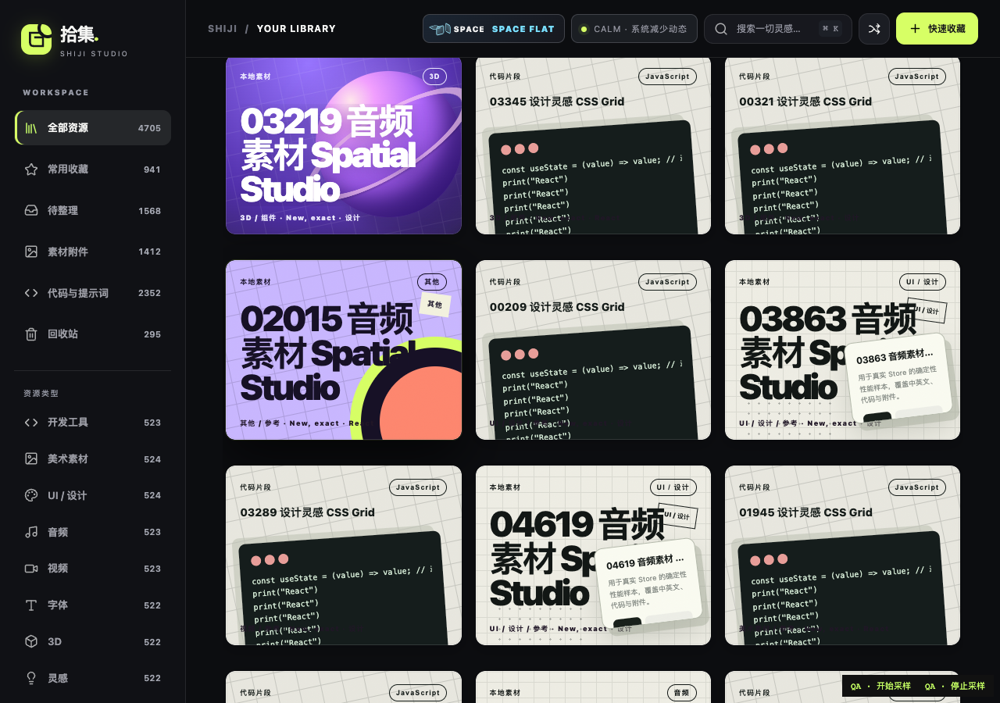
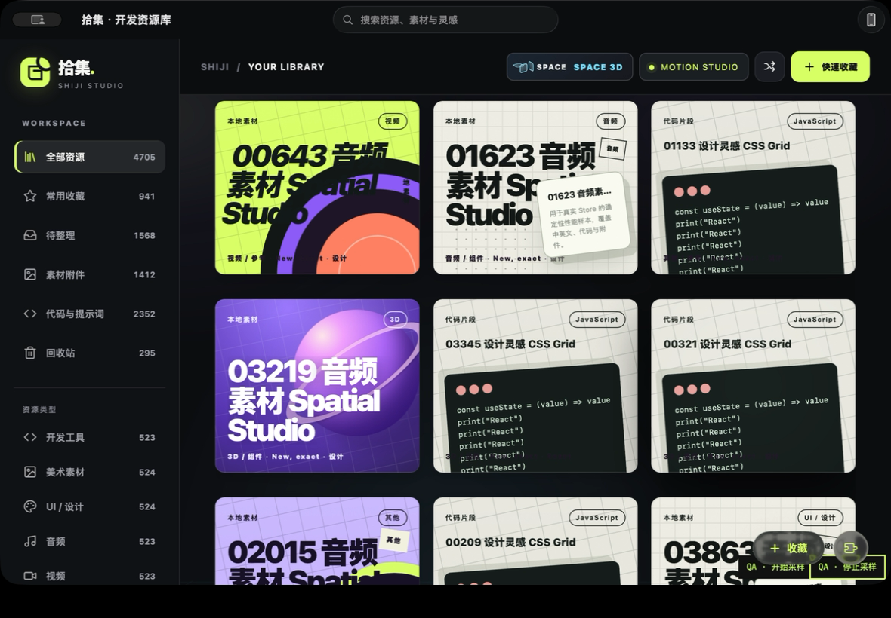

# SHIJI V6.3 — Gallery Performance & Stability

Candidate: `feat/shiji-v6.3-gallery-performance`, based on V6.2 `579d447`. This branch changes gallery residency and presentation work; resource ownership, backend query/filter semantics, schema 3, ZIP manifest 2, mobile JSON and sync protocol 1 remain unchanged. No main merge or formal-library operation was performed.

## Findings and repairs

| Problem / reproduction | Cause | Result |
|---|---|---|
| V6.2 Ubuntu slow-capability test fails before the first query finishes | External script delivery consumed the same deadline as an artificial 3300ms sleep; the test did not establish when capability discovery actually began | Explicit first-request barrier and actual heartbeat callback; original six-second condition deadline retained. Original fails on Mac and Ubuntu; repaired test passes; readiness-gate mutation fails. See CI.md. |
| Append 60→2040 and scroll in Studio/3D | Every loaded card remained in DOM with complex 3D cover layers. Every append regenerated all loaded HTML; highlights repeatedly scanned mounted DOM | Variable-height/spanned geometry cache, viewport/overscan mounting, bounded markup cache, no-op unchanged residency; existing ShijiBits remains layout/FLIP/Tilt owner. Trace attribution and repeated measurements in PERFORMANCE.md. |
| Tab or pointer interaction while residency slides | Reconciler moved retained nodes before removing departing siblings, potentially disturbing focused/pressed nodes | Remove departures first, then keyed reconciliation; pointer/focus/detail pins and keyboard mounting across the logical sequence. Actual Store edit between pointer-down/up covered. |
| Escape during pending detail hydration | A late response could open a drawer after cancellation | Invalidate the current hydration generation, release current origin pin; delayed response test verifies drawer remains closed. |
| Frame→fit after cover already decoded | No new image-load event occurred to supply aspect ratio; temporary fit height could diverge from original CSS | Read decoded dimensions, actual CSS constraints and bounded mounted-height corrections. Stable-ID screen anchor survives repacking and corrections defer while the detail drawer locks scrolling. |
| Search keyboard entry at bottom of loaded results | First mounted row differs from first logical result under windowing | Ensure the first logical result is mounted before focus/Enter; no second click required. |
| Clear search / change filters after full-match selection | Retained highlight marks and full-query selection token could outlive the query identity | Clear obsolete marks; invalidate full-match selection on query identity changes. Selection continues to refer to canonical IDs/full server match, never mounted DOM. |
| Repeated gallery appends rebuild unrelated presentation | Spatial Deck rebuilt the same three covers; V2's transient Hero toggle ran before V5 scope update | Cache deck by actual cover inputs; skip the V2-only visibility toggle on V5. Full-size V5 Hero and art remain intact. |
| Enrichment changes name-sort order between pointer-down and release | Residency pins did not stop global render from releasing capture, reordering DOM and moving the hit area | Fence only global presentation through pointer-up/click; flush the latest render once, including blur/cancel recovery. Removing this fence in an isolated mutation reproduces the failed first click. |
| Held detail A returns after cached B opens or query/revision changes | Synchronous opens did not invalidate the older generation; payload writes occurred before checking intent | Fence state/cache writes by generation/query/revision, invalidate every detail/edit intent, and ignore cancelled payloads before mutation. Unit and actual-browser RED→GREEN. |
| Responsive reflow leaves a drifting visible anchor | Explicit correction inherited the page's smooth-scrolling CSS | Instant correction preserves screen offset; actual delayed image decode and scrolled resizing regression now pass without widening tolerance. |

## Actual delivery

Product files: `static/gallery-window.js` (geometry/residency), `resource-bits.js` (existing layout owner integration), `stable-cards.js` (keyed ordering), `app.js` and `query-integration.js` (existing state/detail/search hooks), `shiji-v5.js` (unchanged-content presentation cache), script load and explicit grid scroll anchoring. No backend or Swift shipping behavior was rewritten. Development-only Playwright supports a real-browser CI job; application packaging excludes node_modules.

Geometry comparison uses identical real Store data, real CSS and stable IDs at 1280, 820 and 390px. Original and candidate positions/sizes/wide spans are within one pixel. Real Chrome regression covers actual save/edit/query APIs, missing covers, long Chinese titles, image ratios, 1020 summaries, rapid scrolling, detail cancellation/return, tabs across residency, all-match selection, list/board fallback and Reduced Motion. See evidence/geometry.json and evidence/window-final-browser.json.

Identical-fixture browser captures (Reduced Motion for stable geometry comparison):

These are real application screenshots. The full native interaction recording is retained at `desktop-app/dist/v63-native-interaction.mp4`; the real-browser regression recording is in `desktop-app/dist/v63-browser-regression-video/` and the browser Actions artifact. Large videos are deliberately not added to Git.

## Verification

- Mac portable Python: 282 passed; Node: 59 groups passed.
- Native Python partition: 2 passed; Swift Core/exchange passed; HTTPS sync passed; macOS app build/ad-hoc signing passed.
- Real Chrome gallery/API regression passed; actual browser video retained in ignored dist and Actions artifact.
- Ubuntu24.04/Python3.12/Node24 local container: full 282 portable + 57 baseline Node groups passed at the CI repair milestone. Subsequent complete hosted tests include the added window regressions.
- Actual hosted interaction-fix candidate `922daa8`: [run 38922840303](https://github.com/SilverLi123/shiji/actions/runs/38922840303), Python/Node/browser/native/capture-recovery all successful. The earlier windowing candidate `245639d` also passed all five jobs. See evidence/ci-latest.json. This records a specific tested revision, not a promise about future edits.

Original test output is retained in `/tmp/shiji-v63-*.log`; reproducible commands are in QA.md and the workflow. The CI diagnosis preserves actual hosted failure logs, controlled delayed-asset RED, Ubuntu reproduction, GREEN and mutation evidence. No skipped tests or widened assertion timeout.

## Native evidence and limits

The separately identified 5K QA App uses only a copied disposable database and fresh credentials. The user brought it to the foreground; logs confirm `hidden=false`. A user-driven sampling interval captured 44 scroll events and 13,418 rAF intervals. This was a mixed, long interaction session, not a fixed 30-second quiet Studio/Calm comparison. Coordinate input later opened a real card; closing returned to the same scrollbar position, with zero residual detail proxies.

The recorded native detail phase still contains a **246ms maximum interval** (P50 17ms, P95 18ms); a foreground/scroll phase also has occasional long intervals. This is the existing native first-detail risk, not resolved by gallery windowing. The raw trace/process evidence is retained and the final performance report separates browser automation, native automation and physical input. Compiling, background AX access or a single good rAF median is not native acceptance.

After the final interaction repairs, both fixed-mode native comparison bundles were built successfully, but launching foreground acceptance was blocked by the Mac locking again. No final fixed-mode comparison is claimed on the basis of those builds. The earlier actual user/coordinate sample remains valid for its own revision (df2c380), with the unresolved246ms detail gap.

## Remaining acceptance and risks

- Native cold-start distributions, physical touchpad inertia, sleep/wake, full-screen transitions and full VoiceOver navigation still require dedicated foreground/manual coverage. An accessible window with `hidden=true` must be excluded.
- Windowing is limited to the pure-cover grid. List and project-board keep the existing explicit rendering path. Geometry/cache memory grows with loaded summaries, although mounted DOM and markup are bounded; the query API still owns pagination and full-match operations.
- Initial fit-mode positions use the existing fallback ratio until an image decodes. Mounted height corrections are anchored; unusual custom CSS or future card chrome must be added to the real geometry regression.
- Chrome layer-count events were unavailable on this headless environment. Inclusive trace composition events are evidence of cost, not an exact layer census or proof of a single GPU cause. Shared GPU-process memory cannot be attributed wholly to this app.
- Existing physical iPhone, Safari/extension installation and device sync acceptance gaps from V6.1/V6.2 remain open; this gallery task does not certify them.
- Deferred minor from the independent review: if a controller is created with positive document/grid width but card CSS measurement subsequently reports zero, its secondary no-geometry path does not populate the legacy grid. Normal zero-layout JSDOM is gated before controller creation; supported real-layout runs passed. Add a dedicated fallback regression before treating arbitrary no-layout hosts as supported.

## Outcome and next work

Resolved: unbounded retained grid DOM for loaded summaries, repeated unchanged-residency work, reproduced hydration cancellation/focus/highlight/selection regressions and the CI lifecycle test race.

Improved: measured large-gallery rendering, browser scrolling and broad-search presentation costs. Exact comparable numbers and limitations belong to PERFORMANCE.md; this is not a blanket 60 FPS claim.

Still present: native first-detail long frame and occasional native long intervals. Do not mark the product release-ready on this branch alone. A formal review PR can describe the verified gallery improvement and explicit native/manual blockers; merging main or publishing a release requires a separate decision.

Next: finish foreground WKWebView trace attribution with the bounded gallery, then resume Search/Cover features on this measured baseline. Keep the original Instruments evidence and perform a separate iPhone Share Extension/device acceptance pass; do not mix those changes into this performance branch.

The independent read-only whole-branch review found two Important races, both reproduced and fixed in922daa8, and one deferred Minor no-geometry edge. Added scrolled-anchor coverage exposed and fixed an additional smooth-scroll correction drift. RED/GREEN and mutation evidence is in evidence/review-regressions.txt; test commands/results in evidence/tests.json. All execution decisions and declined-to-judge rulings are preserved in DECISIONS.md. The worktree and pending native acceptance ledger are retained for continuation; no PR or main merge was performed.
